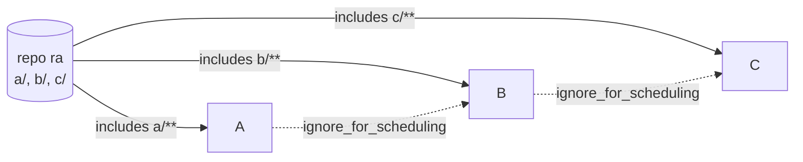
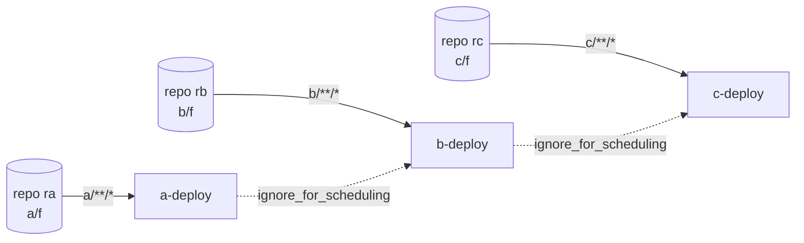
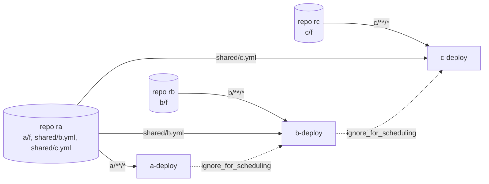
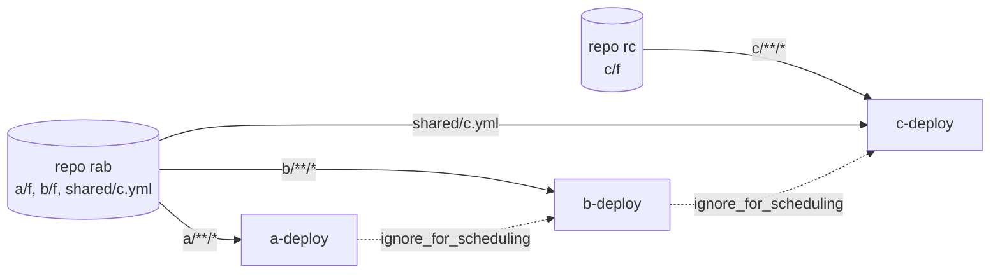
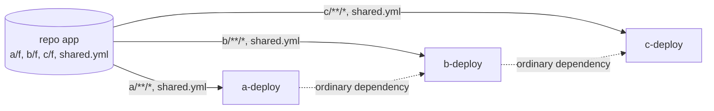
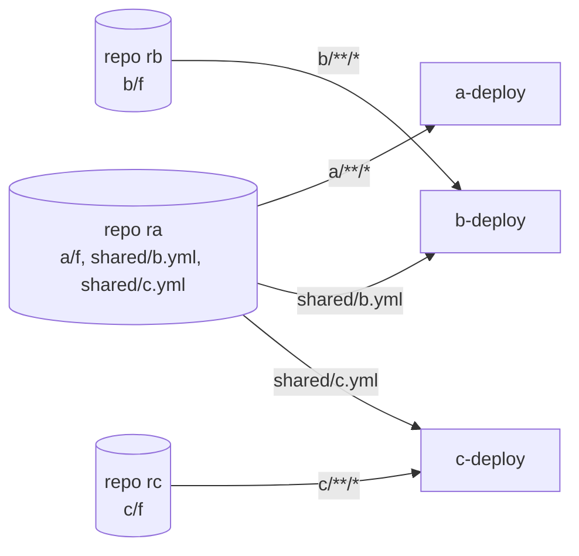
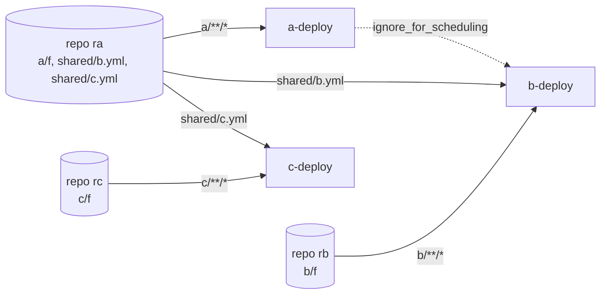
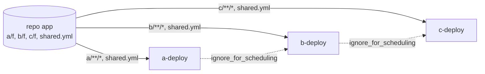

# Fan-in with a shared, filtered material and an `ignore_for_scheduling` dependency

One document: the problem, the solution and how its two parts relate, what the pull request contains, the commits, the test
results for the stock server, the first patch and the final patch side by side, and the behaviour in seven repository
layouts. Examples use generic names: pipelines `A`, `B`, `C` and repositories `ra`, `rb`, `rc`.

## 1. The problem

A pipeline holds a git material with a whitelist (`includes`) and a dependency material with `ignore_for_scheduling: true`
on a pipeline that watches the **same repository**. A commit that matches only the downstream pipeline's whitelist never
schedules it, until the upstream pipeline builds something again. There is no error and no health message.

Cause, in `FanInGraph`: the material is de-duplicated across the pipelines by fingerprint, and `scmMaterialsOfDepChildren`
pins the downstream's direct revision to the revision its dependency's current instance embeds. The pin ignores
`ignoreForScheduling`. If the upstream never builds the new commit (its whitelist does not match), nothing moves the pin.

A commit touching only `c/` freezes C on a stock server. A commit touching `a/`, `b/` and `c/` builds A, then B, then C,
because the pin makes each wait for the previous one.

## 2. The solution: two parts that belong together

### 2.1 Fan-in (`FanInGraph.scmMaterialsOfDepChildren`)

For an `ignoreForScheduling` dependency, the pin is kept only when the upstream **will build** a commit newer than the one
it last built, decided with GoCD's own filter check (`Modifications.shouldBeIgnoredByFilterIn`) against the upstream's own
filter for that repository. Otherwise there is no pin.

- Upstream will build the commit: the downstream waits (the order is kept, as for an ordinary dependency).
- Upstream will never build it: no pin (no freeze).
- "What the upstream last built" is read from its **most recent** instance, not from the instance fan-in is considering (it
  backtracks to an older compatible one) and not from the fan-in set. Measuring from either counts commits already built as
  pending, and freezes the pipeline one level down.

A first version of the change never kept the pin for an ignored dependency. It fixed the freeze but lost the order: on a
commit matching every whitelist, A, B and C started together. The final change keeps the order and still fixes the freeze.

### 2.2 Value Stream Map (`ValueStreamMapService.traverseUpstream`, `ValueStreamMap`)

The map showed "Built from incompatible revisions" when a pipeline's materials resolved to different revisions of the
repository. A revision reached **only** through an `ignoreForScheduling` dependency is now left out of that test. A revision
that is also reached through an ordinary dependency still counts.

### 2.3 How they relate

The fan-in change lets a pipeline run on a newer revision of the shared repository than the one its upstream built. That is
the intended result: the dependency is declared not to take part in scheduling, so it must not hold the pipeline back on a
revision the upstream will never build. The Value Stream Map, however, compares the revisions of all materials of a run and
warns when they differ, so it would warn on every run the fix now allows, about a difference the user asked for.

- Without the VSM change, scheduling is correct and the map shows a false warning on those runs.
- Without the fan-in change, the VSM change has nothing to act on: the pipeline is frozen and never runs.
- The code does not overlap (`FanInGraph` and its tests against `ValueStreamMap`, `ValueStreamMapService` and their tests),
  so each part can be reviewed on its own. They are proposed together because the second exists only to remove a warning that
  the first makes appear.

Known trade-off, pinned by a test: when the pin is skipped, a run can combine the new direct revision with the upstream's
older instance.

## 3. What the pull request contains

Branch `fix/fanin-ignore-for-scheduling-pin`, based on current master, three commits:

| Commit | What |
|---|---|
| `ca933d7fc0` | test helper: `GitCommand.add` resolves a file in a subdirectory by its path relative to the working directory |
| `3cede93bfd` | fan-in change and its tests |
| `c732a8b116` | VSM change and its tests |

Tests added: in `FaninDependencyResolutionTest`, the freeze in a diamond with a filtered shared material; the pin kept when the
upstream will build the commit (no filter, and both filters matching); no pin when it never will; the pin kept for an ordinary
dependency; a blacklist filter on the downstream; a three-level chain. In
`BuildCauseProducerServiceDependencyIntegrationTest`, a filtered SCM material with an ignored dependency. In
`ValueStreamMapTest`, a diamond with no warning and the same diamond with an ordinary path that still warns.

Not covered: hg and svn variants of the pin tests; p4 and tfs; whether a manual "trigger with options" proposes the same
revision as the scheduler (the same question applies to the pinned revision on a stock server).

### Proposed pull request description

**Title:** fix(fan-in): an ignoreForScheduling dependency no longer freezes a pipeline that shares a filtered SCM material

A pipeline with a whitelisted git material and an `ignore_for_scheduling` dependency on a pipeline that watches the same
repository stops scheduling for commits that only its own whitelist matches, until the upstream builds again (section 1).
The pin to the upstream's revision is now kept only when the upstream will itself build a newer commit, so the downstream
still waits for it and the order is kept; otherwise there is no pin (section 2.1). The Value Stream Map no longer warns
about a revision reached only through an ignored dependency, because the fix now allows exactly that (section 2.3).

Verification: the three suites below on a stock server, with the first version of the change, and with the final change;
the layouts of section 6 run end to end against real servers. Related discussion: the issue that describes the behaviour.

## 4. Commits

The same change exists for the 26.1.0 release line on the fork's `cbp/26.1.0` branch. Its history, all pushed to
`github.com/cbroult/gocd`:

| Commit | Branch | What |
|---|---|---|
| `d6aaed9453fc4af1948dd42553bc302c5583241f` | `cbp/26.1.0` | first version: an ignored dependency no longer pins a shared SCM material; diamond regression test |
| `6efe2e6d22df888fa0ea8cec8f32b7e1945e9466` | `cbp/26.1.0` | test helper: `GitCommand.add` keeps a relative File's name as its pathspec |
| `87b839c0b53e2948bd409797a93387e77a4b8f2c` | `cbp/26.1.0` | test: plain `assertThat` in the diamond test on 26.1.0 |
| `a7ed761ccc0c1b46d6856c49f97732d6af987da6` | `cbp/26.1.0` | VSM change |
| `91959ba71bf3d99bf05630732e94cf6f46ab858f` | `cbp/26.1.0` | refined fan-in: keep the pin when the upstream will build the newer commit |
| `04a63654fc793035f036577c6dd189428a4323d0`, `9200ddff1adebb035370cfd962698facc04d338f`, `2ea0f515a9700a9e5b91fe11bc153758199ce812`, `7496341d8eadfc2404d7d70d44216c2fa5e77a48`, `27bed32acdbf6079e153d84458ec5713db3fedae`, `a38b4020b4adbe5962f792864405bed11b2756a7` | `fix/faninsql-diamond-pin-rebased` | the earlier master-based branch (superseded by `fix/fanin-ignore-for-scheduling-pin`) |
| `ca933d7fc0`, `3cede93bfd`, `c732a8b116` | `fix/fanin-ignore-for-scheduling-pin` | the clean series of section 3 |

## 5. Test results: stock, first patch, final

The tests of the clean branch (`c732a8b116`) run against three versions of `FanInGraph.java`: stock (master), the first version
of the change (`04a63654fc`), and the final one. Command:
`./gradlew :server:integrationTest --tests '*FaninDependencyResolutionTest' --tests '*BuildCauseProducerServiceDependencyIntegrationTest'`
(33 tests, JDK 25, 2026-10-28). The table lists every test that fails on at least one version; all others pass on all
three.

| Test | Stock | First patch | Final |
|---|---|---|---|
| `shouldKeepThePinForACommitOnlyTheUpstreamBuilds_soTheDownstreamStaysOnTheUpstreamsRevision` | pass | ❌ **fail** | pass |
| `shouldKeepThePinWhenBothWhitelistsMatchTheNewerCommit` | pass | ❌ **fail** | pass |
| `shouldKeepThePinWhenIgnoredUpstreamWillBuildTheNewerCommit_soDownstreamWaitsForIt` | pass | ❌ **fail** | pass |
| `shouldNotPinThirdLevelPipelineToAnOlderRevision_whenTheMiddlePipelineWillNeverBuildTheNewCommit` | ❌ **fail** | pass | pass |
| `shouldNotPinWhenIgnoredUpstreamWillNeverBuildTheNewerCommit_soDownstreamIsNotFrozen` | ❌ **fail** | pass | pass |
| `shouldNotPinWhenTheDownstreamFilterIsABlacklist_andTheUpstreamWillNeverBuildTheNewerCommit` | ❌ **fail** | pass | pass |
| `shouldScheduleDownstreamPipeline_withDiamondSharedFilteredMaterialAndIgnoredDependencyMaterial_whenFilteredMaterialHasMatchingChanges` | ❌ **fail** | pass | pass |
| **Failing, of 33** | 4 | 3 | 0 |

❌ marks a failing test, that is, behaviour that is broken.

Reading it: stock freezes, the first patch fixes the freeze and loses the order, the final change does both. On the clean branch
`ValueStreamMapTest` and `ValueStreamMapServiceTest` pass (22 and 22). `GitCommandSubmodulesTest` fails 9 of 13 in the environment
used here, with and without this change (the same failures on master).

## 6. Behaviour across repository layouts (end to end)

Seven layouts run against real servers (a stock `gocd/gocd-server:v26.1.0`, the first version of the change, and the final
one), each step written down as an expectation before it ran. The tables are generated by `variations.rb doc` from the data the
runs use.

Summary:

- The freeze is reproduced on stock, and fixed by both versions, in every layout that shares a repository (V2 and V3 steps 1
  and 2, V6 step 2, V7 steps 1 and 2).
- The first version loses the order on a commit matching every whitelist (V2, V3 and V7 step 5 or 4: started together); the final
  change keeps it.
- Separate repositories (V1) and ordinary dependencies (V4, the control) behave the same on all three.
- Without dependency materials (V5), only the pipelines whose whitelist matches build.
- With a dependency and a shared repository (V6), the downstream follows the upstream's run on every version: existing behaviour,
  not changed here.

Each step PASSes when the set of pipelines that scheduled equals the expectation; "ordered" means each started after the previous
finished. ❌ marks behaviour that is broken: the server froze a pipeline that should have built, or lost the order the dependency
gives. PASS means the run matched the prediction, including when the predicted behaviour is a broken one. A material poll is about
a minute, so each step waits up to 180 s for an expected run and 75 s more for an unexpected one.

### Overview

| Variation | Layout | What it shows |
|---|---|---|
| [V1](#v1-three-separate-repositories-a-to-b-to-c-by-dependency) | Three separate repositories, A to B to C by dependency | Control: three separate repositories. No shared material, so no difference between the servers. |
| [V2](#v2-separate-repositories-b-and-c-also-monitor-a-file-in-as-repository) | Separate repositories, B and C also monitor a file in A's repository | B and C also monitor a file in A's repository. Reproduces the freeze and the lost order. |
| [V3](#v3-a-and-b-share-a-repository-c-is-separate-and-monitors-a-file-in-the-shared-one) | A and B share a repository, C is separate and monitors a file in the shared one | A and B share a repository, C is separate and monitors a file in it. The freeze and the lost order again. |
| [V4](#v4-one-repository-ordinary-dependencies-not-ignored-for-scheduling-the-control) | One repository, ordinary dependencies (not ignored for scheduling): the control | Control: one repository, ordinary dependencies. The behaviour the refined patch has to keep. |
| [V5](#v5-v2s-repositories-and-whitelists-with-no-dependency-materials-is-the-upstreams-run-what-drags-b-and-c-along) | V2's repositories and whitelists with NO dependency materials: is the upstream's run what drags B and C along? | V2 without dependency materials. Isolation run: does the upstream's run drag B and C along? |
| [V6](#v6-v2s-repositories-with-only-b-depending-on-a-c-has-no-dependency) | V2's repositories with only B depending on A (C has no dependency) | V2 with only B depending on A. Isolation run: a downstream sharing the repository follows its upstream's run. |
| [V7](#v7-one-repository-three-whitelists-ignored-dependencies-the-originally-reported-shape) | One repository, three whitelists, ignored dependencies: the originally reported shape | One repository with three whitelists and ignored dependencies: the shape that was originally reported. |

### V1: Three separate repositories, A to B to C by dependency

| Step | What changes | Expected stock | Expected patched | Expected refined | Observed stock | Observed patched | Observed refined |
|---|---|---|---|---|---|---|---|
| 0 | initial commits: every pipeline has its first run | A, B, C | A, B, C | A, B, C | PASS: A, B, C (ordered, 39.0s) | PASS: A, B, C (ordered, 39.0s) | PASS: A, B, C (ordered, 39.0s) |
| 1 | C's own repository changes | C | C | C | PASS: C | PASS: C | PASS: C |
| 2 | B's own repository changes | B | B | B | PASS: B | PASS: B | PASS: B |
| 3 | A's repository changes (dependencies are ignored for scheduling, so B and C stay quiet) | A | A | A | PASS: A | PASS: A | PASS: A |
| 4 | all three repositories change | A, B, C | A, B, C | A, B, C | PASS: A, B, C (together, 0.0s) | PASS: A, B, C (together, 0.0s) | PASS: A, B, C (together, 0.0s) |

### V2: Separate repositories, B and C also monitor a file in A's repository

| Step | What changes | Expected stock | Expected patched | Expected refined | Observed stock | Observed patched | Observed refined |
|---|---|---|---|---|---|---|---|
| 0 | initial commits | A, B, C | A, B, C | A, B, C | PASS: A, B, C (ordered, 40.0s) | PASS: A, B, C (ordered, 40.0s) | PASS: A, B, C (ordered, 39.0s) |
| 1 | only the file B monitors in A's repository changes (A's whitelist does not match) | ❌ **none** | B | B | ❌ **PASS: none** | PASS: B | PASS: B |
| 2 | only the file C monitors in A's repository changes | ❌ **none** | C | C | ❌ **PASS: none** | PASS: C | PASS: C |
| 3 | B's own repository changes | B | B | B | PASS: B | PASS: B | PASS: B |
| 4 | A's own directory changes: B and C follow it (B and C share its repository; measured on stock, patched and refined) | A, B, C | A, B, C | A, B, C | PASS: A, B, C (ordered, 50.0s) | PASS: A, B, C (ordered, 60.0s) | PASS: A, B, C (ordered, 60.0s) |
| 5 | A's directory and both monitored files change in one commit | A, B, C | A, B, C | A, B, C in order | PASS: A, B, C (ordered, 40.0s) | ❌ **PASS: A, B, C (together, 0.0s)** | PASS: A, B, C (ordered, 20.0s) |

### V3: A and B share a repository, C is separate and monitors a file in the shared one

| Step | What changes | Expected stock | Expected patched | Expected refined | Observed stock | Observed patched | Observed refined |
|---|---|---|---|---|---|---|---|
| 0 | initial commits | A, B, C | A, B, C | A, B, C | PASS: A, B, C (ordered, 39.0s) | PASS: A, B, C (ordered, 39.0s) | PASS: A, B, C (ordered, 39.0s) |
| 1 | only B's directory changes in the shared repository (the shape of the original freeze) | ❌ **none** | B | B | ❌ **PASS: none** | PASS: B | PASS: B |
| 2 | only the file C monitors changes | ❌ **none** | C | C | ❌ **PASS: none** | PASS: C | PASS: C |
| 3 | C's own repository changes | C | C | C | PASS: C | PASS: C | PASS: C |
| 4 | A's directory changes: B and C follow it (measured on stock, patched and refined) | A, B, C | A, B, C | A, B, C | PASS: A, B, C (ordered, 40.0s) | PASS: A, B, C (ordered, 60.0s) | PASS: A, B, C (ordered, 60.0s) |
| 5 | A's and B's directories and the monitored file change together | A, B, C | A, B, C | A, B, C in order | PASS: A, B, C (ordered, 50.0s) | ❌ **PASS: A, B, C (together, 0.0s)** | PASS: A, B, C (ordered, 20.0s) |

### V4: One repository, ordinary dependencies (not ignored for scheduling): the control

| Step | What changes | Expected stock | Expected patched | Expected refined | Observed stock | Observed patched | Observed refined |
|---|---|---|---|---|---|---|---|
| 0 | initial commit touches all three whitelists | A, B, C | A, B, C | A, B, C | PASS: A, B, C (ordered, 59.0s) | PASS: A, B, C (ordered, 49.0s) | PASS: A, B, C (ordered, 49.0s) |
| 1 | only C's directory changes (an ordinary dependency still pins C to B's revision) | none | none | none | PASS: none | PASS: none | PASS: none |
| 2 | only A's directory changes: A passes, which triggers B, which triggers C | A, B, C | A, B, C | A, B, C | PASS: A, B, C (ordered, 50.0s) | PASS: A, B, C (ordered, 40.0s) | PASS: A, B, C (ordered, 50.0s) |
| 3 | the shared file changes: all three whitelists match | A, B, C | A, B, C | A, B, C | PASS: A, B, C (ordered, 40.0s) | PASS: A, B, C (ordered, 40.0s) | PASS: A, B, C (ordered, 40.0s) |

### V5: V2's repositories and whitelists with NO dependency materials: is the upstream's run what drags B and C along?

| Step | What changes | Expected stock | Expected patched | Expected refined | Observed stock | Observed patched | Observed refined |
|---|---|---|---|---|---|---|---|
| 0 | initial commits | A, B, C | A, B, C | A, B, C | PASS: A, B, C (together, 0.0s) | PASS: A, B, C (together, 0.0s) | PASS: A, B, C (together, 0.0s) |
| 1 | only A's own directory changes (nothing B or C watches changes) | A | A | A | PASS: A | PASS: A | PASS: A |
| 2 | only the file B monitors changes | B | B | B | PASS: B | PASS: B | PASS: B |
| 3 | A's own directory changes again, after B has built | A | A | A | PASS: A | PASS: A | PASS: A |

### V6: V2's repositories with only B depending on A (C has no dependency)

| Step | What changes | Expected stock | Expected patched | Expected refined | Observed stock | Observed patched | Observed refined |
|---|---|---|---|---|---|---|---|
| 0 | initial commits | A, B, C | A, B, C | A, B, C | PASS: A, B, C (ordered, 29.0s) | PASS: A, B, C (ordered, 29.1s) | PASS: A, B, C (ordered, 29.0s) |
| 1 | A's own directory changes: B, sharing the repository, follows A's run; C, with no dependency, does not | A, B | A, B | A, B | PASS: A, B (ordered, 30.0s) | PASS: A, B (ordered, 30.0s) | PASS: A, B (ordered, 20.0s) |
| 2 | only the file B monitors changes | ❌ **none** | B | B | ❌ **PASS: none** | PASS: B | PASS: B |
| 3 | A's own directory changes again, after B has built: B follows again | A, B | A, B | A, B | PASS: A, B (ordered, 20.0s) | PASS: A, B (ordered, 20.0s) | PASS: A, B (ordered, 20.0s) |

### V7: One repository, three whitelists, ignored dependencies: the originally reported shape

| Step | What changes | Expected stock | Expected patched | Expected refined | Observed stock | Observed patched | Observed refined |
|---|---|---|---|---|---|---|---|
| 0 | initial commit touches all three whitelists | A, B, C | A, B, C | A, B, C | PASS: A, B, C (ordered, 49.0s) | PASS: A, B, C (ordered, 49.0s) | PASS: A, B, C (ordered, 39.0s) |
| 1 | only C's directory changes (A and B will never build this commit) | ❌ **none** | C | C | ❌ **PASS: none** | PASS: C | PASS: C |
| 2 | only B's directory changes | ❌ **none** | B | B | ❌ **PASS: none** | PASS: B | PASS: B |
| 3 | only A's directory changes: B and C follow A's run | A, B, C | A, B, C | A, B, C | PASS: A, B, C (ordered, 50.0s) | PASS: A, B, C (ordered, 40.0s) | PASS: A, B, C (ordered, 40.0s) |
| 4 | the shared file changes: all three whitelists match, so the dependency order should hold | A, B, C | A, B, C | A, B, C in order | PASS: A, B, C (ordered, 40.0s) | ❌ **PASS: A, B, C (together, 0.0s)** | PASS: A, B, C (ordered, 20.1s) |

## 7. Reproducing

`ruby variations.rb run V7 stock` (or `patched`, `refined`) runs one layout against one server image; `ruby variations.rb all`
runs them all in parallel; `ruby variations.rb doc` prints the report above. It needs docker, git and ruby. Images are chosen with
`STOCK_IMAGE`, `PATCHED_IMAGE`, `REFINED_IMAGE` and `AGENT_IMAGE`; evidence (the generated config, every API answer, `results.json`,
`run.log`) lands in `out/variations/`.
