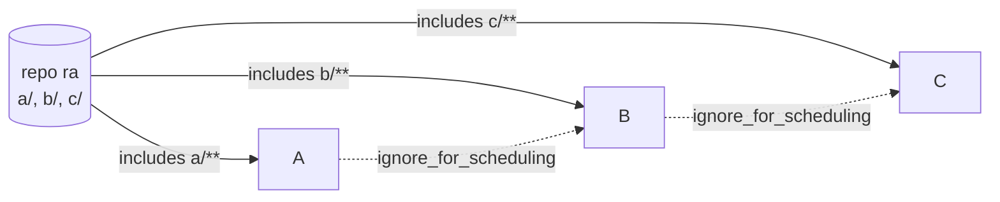
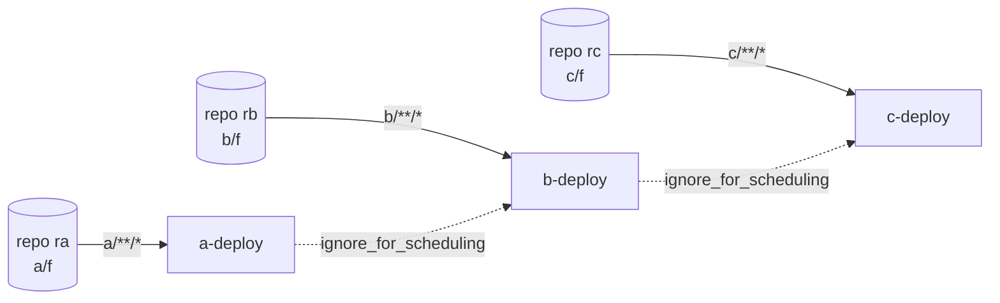
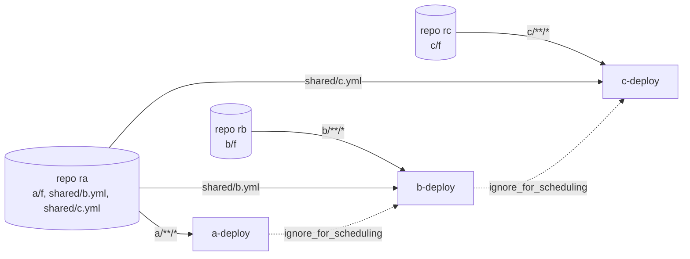
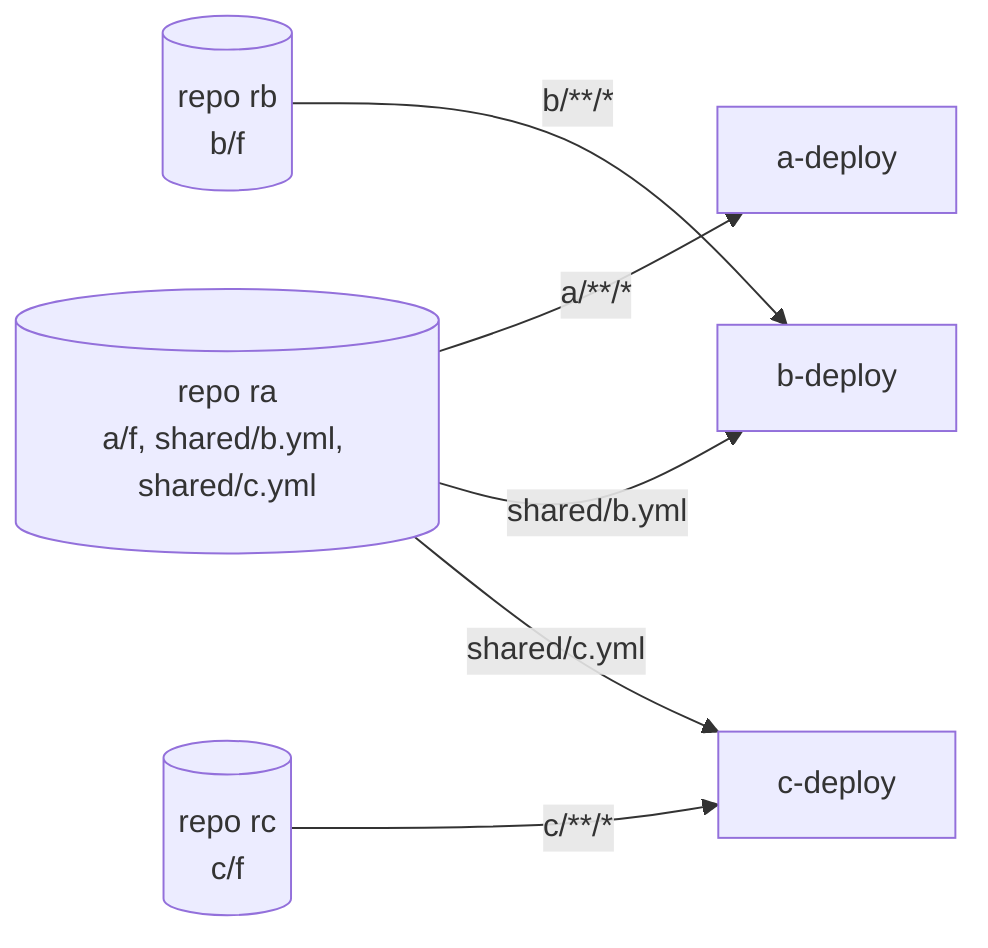
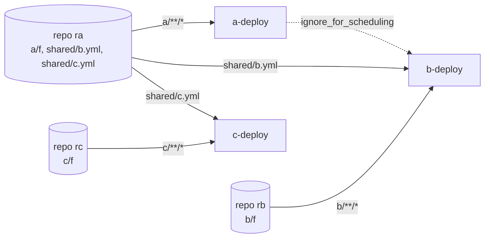
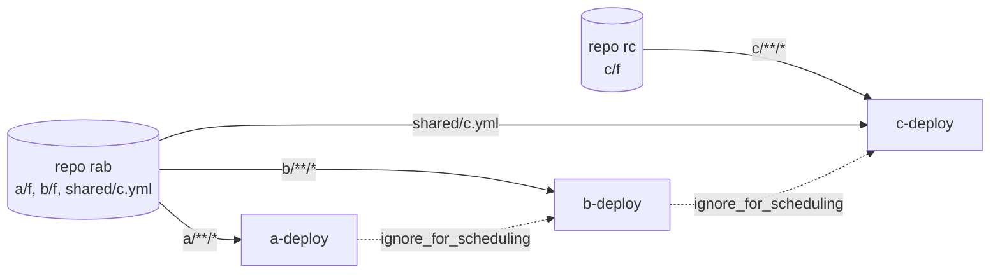
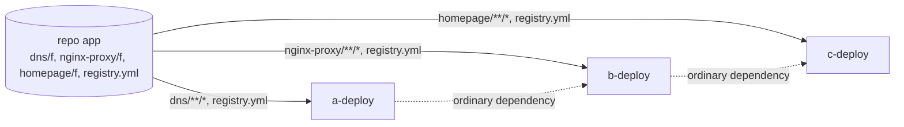

# Fan-in with a shared, filtered material and an `ignore_for_scheduling` dependency

One document: the problem, the solution and what a pull request would contain, every commit, the test results for the
stock server, the first patch and the refined patch side by side, and worked examples. Examples use generic names:
pipelines `A`, `B`, `C` and repositories `ra`, `rb`, `rc`.

## 1. The problem

A pipeline holds a git material with a whitelist (`includes`) and a dependency material with
`ignore_for_scheduling: true` on a pipeline that watches the **same repository**. A commit that matches only the
downstream pipeline's whitelist never schedules it, until the upstream pipeline builds something again. There is no error and no
health message.

Cause, in `FanInGraph`: the material is de-duplicated across the pipelines by fingerprint, and `scmMaterialsOfDepChildren`
pins the downstream's direct revision to the revision its dependency's current instance embeds. The pin ignores
`ignoreForScheduling`. If the upstream never builds the new commit (its whitelist does not match), nothing moves the pin.

A commit touching only `c/` freezes C on stock. A commit touching `a/`, `b/` and `c/` builds A, then B, then C on stock,
because the pin makes each wait for the previous one.

## 2. The solution, and what the pull request contains

Two changes, to be proposed together.

**Fan-in (`FanInGraph.scmMaterialsOfDepChildren`).** For an `ignoreForScheduling` dependency, the pin is kept only when
the upstream **will build** a commit newer than the one it last built, decided with GoCD's own filter check
(`Modifications.shouldBeIgnoredByFilterIn`) against the upstream's own filter for that repository. Otherwise there is no pin.

- Upstream will build the commit: the downstream waits (order kept, as for an ordinary dependency).
- Upstream will never build it: no pin (no freeze).
- "What the upstream last built" is read from its **most recent** instance, not from the instance fan-in is considering
  (it backtracks to an older compatible one) and not from the fan-in set; measuring from either counts commits already
  built as pending, and freezes the pipeline one level down.

**Value Stream Map (`ValueStreamMapService.traverseUpstream`, `ValueStreamMap`).** A material revision reached only through
an ignored dependency is left out of the "Built from incompatible revisions" test. A revision also reached through an
ordinary dependency still counts.

Known trade-off, pinned by a test: when the pin is skipped, a run can combine the new direct revision with the upstream's
older instance. The first patch alone (pin never kept for an ignored dependency) also lost the order; the refined patch
exists to keep it.

Observed on stock and on every version: when A, B and C share a repository, a downstream pipeline follows its upstream's
run even when its own whitelist does not match the commit (variation V6). That is existing behaviour; this change does not
alter it.

## 3. Commits

All pushed to `github.com/cbroult/gocd`.

| Commit | Branch | What |
|---|---|---|
| `d6aaed9453fc4af1948dd42553bc302c5583241f` | `cbp/26.1.0` | first patch: an ignored dependency no longer pins a shared SCM material; diamond regression test |
| `04a63654fc793035f036577c6dd189428a4323d0` | `fix/faninsql-diamond-pin-rebased` | the same patch rebased on master (PR branch; gocd/gocd#14647, closed) |
| `6efe2e6d22df888fa0ea8cec8f32b7e1945e9466` | `cbp/26.1.0` | test helper: `GitCommand.add` keeps a relative File's name as its pathspec (fixes `GitCommandSubmodulesTest`) |
| `87b839c0b53e2948bd409797a93387e77a4b8f2c` | `cbp/26.1.0` | test: plain `assertThat` in the diamond test on 26.1.0 |
| `a7ed761ccc0c1b46d6856c49f97732d6af987da6` | `cbp/26.1.0` | VSM: no "incompatible revisions" warning for a revision reached only through an ignored dependency |
| `91959ba71bf3d99bf05630732e94cf6f46ab858f` | `cbp/26.1.0` | refined fan-in: keep the pin when the upstream will build the newer commit |

Also pushed: `9200ddff1adebb035370cfd962698facc04d338f` on `fix/faninsql-diamond-pin-rebased` (the `GitCommand` test-helper fix
for the PR branch, 2026-10-06). The PR branch ends there; the refined patch and the VSM change are only on `cbp/26.1.0` so far.

## 4. Test results: stock, first patch, refined

Same test files (those of `91959ba71b`) run against three versions of `FanInGraph.java`: stock `55b7b46051`, first patch
`87b839c0b5`, refined `91959ba71b`. Command:
`./gradlew :server:integrationTest --tests '*FaninDependencyResolutionTest' --tests '*BuildCauseProducerServiceDependencyIntegrationTest'`
(31 tests; JDK 25; run 2026-10-28).

| Test | Stock | First patch | Refined |
|---|---|---|---|
| `shouldScheduleDownstreamPipeline_withDiamondSharedFilteredMaterialAndIgnoredDependencyMaterial_whenFilteredMaterialHasMatchingChanges` (the freeze) | **fail** | pass | pass |
| `shouldNotPinWhenIgnoredUpstreamWillNeverBuildTheNewerCommit_soDownstreamIsNotFrozen` | **fail** | pass | pass |
| `shouldNotPinThirdLevelPipelineToAnOlderRevision_whenTheMiddlePipelineWillNeverBuildTheNewCommit` | **fail** | pass | pass |
| `shouldKeepThePinWhenIgnoredUpstreamWillBuildTheNewerCommit_soDownstreamWaitsForIt` | pass | **fail** | pass |
| `shouldKeepThePinWhenBothWhitelistsMatchTheNewerCommit` | pass | **fail** | pass |
| `shouldKeepThePinForACommitOnlyTheUpstreamBuilds_soTheDownstreamStaysOnTheUpstreamsRevision` | pass | **fail** | pass |
| the other 25 (existing fan-in, diamond and dependency integration tests) | pass | pass | pass |
| **Total (31)** | 3 fail | 3 fail | 0 fail |

Reading it: stock freezes, the first patch fixes the freeze and loses the order, the refined patch does both. The
`ValueStreamMapTest` and `ValueStreamMapServiceTest` suites pass at `91959ba71b` (22 and 22 per the earlier record; the
run of 2026-10-28 reported BUILD SUCCESSFUL). The VSM tests need the VSM change and are not run against the stock sources.

Separately, `gocd-build` ran the whole suite against the release for the refined build and found nothing it breaks that
the release passes (2337 classes compared). Not run: `p4` and `hg`-dependent tests (environmental).

## 5. Behaviour across repository layouts (end to end)

Six layouts (V1 to V6) run against real servers (stock `gocd/gocd-server:v26.1.0`, first patch, refined), each step written down as an
expectation before it ran. The tables below are generated from the harness data (`variations.py doc`).

Summary:

- The freeze is reproduced on stock, and fixed by both patches, in every layout that shares a repository (V2, V3 steps 1 and 2).
- The first patch loses the order on a commit matching every whitelist (V2, V3 step 5: 0.0 s apart); the refined patch keeps it (20 s apart, in order).
- Separate repositories (V1) and ordinary dependencies (V4, the control) behave the same on all three.
- Without dependency materials (V5), only the pipelines whose whitelist matches build.
- With a dependency and a shared repository (V6), the downstream follows the upstream's run on every version.

### Layouts and results

Each step PASSes when the set of pipelines that scheduled equals the expectation. "ordered" means each started after the previous finished.

#### V1: Three separate repositories, A to B to C by dependency

| Step | What changes | Expected stock | Expected patched | Expected refined | Observed stock | Observed patched | Observed refined |
|---|---|---|---|---|---|---|---|
| 0 | initial commits: every pipeline has its first run | A, B, C | A, B, C | A, B, C | PASS: A, B, C (ordered, 39.0s) | PASS: A, B, C (ordered, 39.0s) | PASS: A, B, C (ordered, 39.0s) |
| 1 | C's own repository changes | C | C | C | PASS: C | PASS: C | PASS: C |
| 2 | B's own repository changes | B | B | B | PASS: B | PASS: B | PASS: B |
| 3 | A's repository changes (dependencies are ignored for scheduling, so B and C stay quiet) | A | A | A | PASS: A | PASS: A | PASS: A |
| 4 | all three repositories change | A, B, C | A, B, C | A, B, C | PASS: A, B, C (together, 0.0s) | PASS: A, B, C (together, 0.0s) | PASS: A, B, C (together, 0.0s) |

#### V2: Separate repositories, B and C also monitor a file in A's repository

| Step | What changes | Expected stock | Expected patched | Expected refined | Observed stock | Observed patched | Observed refined |
|---|---|---|---|---|---|---|---|
| 0 | initial commits | A, B, C | A, B, C | A, B, C | PASS: A, B, C (ordered, 40.0s) | PASS: A, B, C (ordered, 40.0s) | PASS: A, B, C (ordered, 39.0s) |
| 1 | only the file B monitors in A's repository changes (A's whitelist does not match) | none | B | B | PASS: none | PASS: B | PASS: B |
| 2 | only the file C monitors in A's repository changes | none | C | C | PASS: none | PASS: C | PASS: C |
| 3 | B's own repository changes | B | B | B | PASS: B | PASS: B | PASS: B |
| 4 | A's own directory changes: B and C follow it (B and C share its repository; measured on stock, patched and refined) | A, B, C | A, B, C | A, B, C | PASS: A, B, C (ordered, 50.0s) | PASS: A, B, C (ordered, 60.0s) | PASS: A, B, C (ordered, 60.0s) |
| 5 | A's directory and both monitored files change in one commit | A, B, C | A, B, C | A, B, C in order | PASS: A, B, C (ordered, 40.0s) | PASS: A, B, C (together, 0.0s) | PASS: A, B, C (ordered, 20.0s) |

#### V5: V2's repositories and whitelists with NO dependency materials: is the upstream's run what drags B and C along?

| Step | What changes | Expected stock | Expected patched | Expected refined | Observed stock | Observed patched | Observed refined |
|---|---|---|---|---|---|---|---|
| 0 | initial commits | A, B, C | A, B, C | A, B, C | PASS: A, B, C (together, 0.0s) | PASS: A, B, C (together, 0.0s) | PASS: A, B, C (together, 0.0s) |
| 1 | only A's own directory changes (nothing B or C watches changes) | A | A | A | PASS: A | PASS: A | PASS: A |
| 2 | only the file B monitors changes | B | B | B | PASS: B | PASS: B | PASS: B |
| 3 | A's own directory changes again, after B has built | A | A | A | PASS: A | PASS: A | PASS: A |

#### V6: V2's repositories with only B depending on A (C has no dependency)

| Step | What changes | Expected stock | Expected patched | Expected refined | Observed stock | Observed patched | Observed refined |
|---|---|---|---|---|---|---|---|
| 0 | initial commits | A, B, C | A, B, C | A, B, C | PASS: A, B, C (ordered, 29.0s) | PASS: A, B, C (ordered, 29.1s) | PASS: A, B, C (ordered, 29.0s) |
| 1 | A's own directory changes: B, sharing the repository, follows A's run; C, with no dependency, does not | A, B | A, B | A, B | PASS: A, B (ordered, 30.0s) | PASS: A, B (ordered, 30.0s) | PASS: A, B (ordered, 20.0s) |
| 2 | only the file B monitors changes | none | B | B | PASS: none | PASS: B | PASS: B |
| 3 | A's own directory changes again, after B has built: B follows again | A, B | A, B | A, B | PASS: A, B (ordered, 20.0s) | PASS: A, B (ordered, 20.0s) | PASS: A, B (ordered, 20.0s) |

#### V3: A and B share a repository, C is separate and monitors a file in the shared one

| Step | What changes | Expected stock | Expected patched | Expected refined | Observed stock | Observed patched | Observed refined |
|---|---|---|---|---|---|---|---|
| 0 | initial commits | A, B, C | A, B, C | A, B, C | PASS: A, B, C (ordered, 39.0s) | PASS: A, B, C (ordered, 39.0s) | PASS: A, B, C (ordered, 39.0s) |
| 1 | only B's directory changes in the shared repository (the shape of the original freeze) | none | B | B | PASS: none | PASS: B | PASS: B |
| 2 | only the file C monitors changes | none | C | C | PASS: none | PASS: C | PASS: C |
| 3 | C's own repository changes | C | C | C | PASS: C | PASS: C | PASS: C |
| 4 | A's directory changes: B and C follow it (measured on stock, patched and refined) | A, B, C | A, B, C | A, B, C | PASS: A, B, C (ordered, 40.0s) | PASS: A, B, C (ordered, 60.0s) | PASS: A, B, C (ordered, 60.0s) |
| 5 | A's and B's directories and the monitored file change together | A, B, C | A, B, C | A, B, C in order | PASS: A, B, C (ordered, 50.0s) | PASS: A, B, C (together, 0.0s) | PASS: A, B, C (ordered, 20.0s) |

#### V4: One repository, ordinary dependencies (not ignored for scheduling): the control

| Step | What changes | Expected stock | Expected patched | Expected refined | Observed stock | Observed patched | Observed refined |
|---|---|---|---|---|---|---|---|
| 0 | initial commit touches all three whitelists | A, B, C | A, B, C | A, B, C | PASS: A, B, C (ordered, 39.0s) | PASS: A, B, C (ordered, 39.1s) | PASS: A, B, C (ordered, 49.0s) |
| 1 | only C's directory changes (an ordinary dependency still pins C to B's revision) | none | none | none | PASS: none | PASS: none | PASS: none |
| 2 | only A's directory changes: A passes, which triggers B, which triggers C | A, B, C | A, B, C | A, B, C | PASS: A, B, C (ordered, 40.0s) | PASS: A, B, C (ordered, 40.0s) | PASS: A, B, C (ordered, 40.0s) |
| 3 | the shared file changes: all three whitelists match | A, B, C | A, B, C | A, B, C | PASS: A, B, C (ordered, 60.0s) | PASS: A, B, C (ordered, 50.0s) | PASS: A, B, C (ordered, 40.0s) |

